<div align="center">



<br>

[](#platforms) [](CHANGELOG.md) [](go.mod) [](LICENSE)

[](docs/rules.md) [](rules/testdata) [](#detection-coverage) [](#status) [](https://github.com/rifqifitriady/ZAAFVesper/actions/workflows/ci.yml)

**[Quick start](#quick-start)** · **[How it works](#how-it-works)** · **[Coverage](#detection-coverage)** · **[Security](#security-model)** · **[Roadmap](#roadmap)** · **[Operations guide](docs/operations.md)** · **[Changelog](CHANGELOG.md)**

</div>

---

**ZAAFVesper** watches what processes actually **do**: what they spawn, which files they touch, which secrets they read, how they persist and whom they talk to. It matches that behaviour against readable rules mapped to MITRE ATT&CK, and when you allow it, it contains the threat.
- **Sources:** on macOS it reads Apple's Endpoint Security through the built-in `eslogger`; on Windows it reads Sysmon; on Linux it reads the kernel directly through eBPF (default) or Sysmon for Linux. Windows and Linux are in preview.
- **One rule language** for all three platforms, modelled on [Fibratus](https://github.com/rabbitstack/fibratus).
- **Every rule ships with test fixtures.**

> *Vesper* is the evening star: a watch that stays awake after dark.

## Status

> [!WARNING]
> **Pre-release.** Every rule passes its fixtures, the code has been through several independent security reviews, and v0.3 proved the sensor live, as root, on throw-away GitHub runners for macOS, Windows and Linux: Atomic Red Team tests fired the rules, and the response actions acted. v0.4 extended that to the containment actions on Windows and Linux and to the new Linux eBPF source. See [docs/validation/](docs/validation/). A GitHub runner is not your machine: the installer, the LaunchDaemon and Full Disk Access **have not been validated on your own Mac**. Treat a first install as a test on a machine you can recover. Open risks: [docs/security/open-findings.md](docs/security/open-findings.md).

## Highlights

<table>
<tr>
<td width="33%" valign="top">

**Behaviour, not signatures**<br>
136 rules: 75 hand-written (61 mostly for macOS, 14 for Windows and Linux) and 61 converted from SigmaHQ. Sequences correlate steps such as *download → write → execute*.

</td>
<td width="33%" valign="top">

**Trust that cannot be borrowed**<br>
Only Apple platform binaries, or a vendor's Team ID **with** a verified Developer ID or App Store signature, are trusted. A self-signed copy of a Team ID is not.

</td>
<td width="33%" valign="top">

**Process-tree context**<br>
Every event carries its ancestry, signing identity and a kernel-unique process id. An unknown or double-forked ancestor counts as suspicious.

</td>
</tr>
<tr>
<td valign="top">

**Sigma and SIEM ready**<br>
`zaafvesper sigma convert` imports Sigma rules. Alerts go to syslog over TLS, a webhook, Splunk HEC or [ZAAFElegia](https://github.com/rifqifitriady/ZAAFElegia) as OCSF findings.

</td>
<td valign="top">

**YARA and network**<br>
Files that run or are written are scanned with YARA, bound to their inode. Socket polling reports connections without an Apple entitlement.

</td>
<td valign="top">

**Careful, opt-in containment**<br>
Kill, suspend, quarantine, re-quarantine, roll back a Launch Agent, or cut a process off in pf. Every action re-checks its target first. **It contains, it does not prevent.**

</td>
</tr>
</table>

## How it works

<p align="center"></p>

1. **Collect.** Endpoint Security on macOS, Sysmon on Windows, eBPF or Sysmon on Linux, and socket polling feed one platform-neutral event model.
2. **Enrich.** The process tree adds parent, ancestry, signing trust and a kernel-unique id. Memory is bounded; under pressure it sheds detail before identity.
3. **Detect.** Rules are indexed by event and evaluated in order; sequences keep bounded state. YARA matches return to the engine as events.
4. **Act.**
   - Alerts go to the console, size-capped JSONL, SIEM outputs and ZAAFElegia.
   - With `--enable-response`, a rule can contain the threat.
   - The sensor reports when its own telemetry degrades.

## See it run

<p align="center"></p>

<sub>Real output of <code>zaafvesper replay</code> over the bundled eslogger test fixtures (synthetic events). Only the first line of each alert is shown, and only some of the alerts.</sub>

## Quick start

No root needed: build, check the rules, replay events.

```bash
git clone https://github.com/rifqifitriady/ZAAFVesper.git && cd ZAAFVesper
make build                                   # pure Go, YARA disabled
./bin/zaafvesper rules validate rules        # parse and type-check every rule
./bin/zaafvesper rules test rules            # run every rule against its fixtures
cat testdata/eslogger/*.jsonl > demo.jsonl
./bin/zaafvesper replay --rules rules demo.jsonl
./bin/zaafvesper coverage --rules rules --navigator -        # ATT&CK Navigator layer
./bin/zaafvesper sigma convert ~/sigma/rules/macos -o my-rules # import Sigma rules
```

**Requirements**
- Go 1.27+.
- macOS 13 or later for the live sensor (`eslogger` ships with the OS).
- For YARA: `brew install yara pkg-config`, then `make build-yara`.

**Run it live on macOS.**
- The sensor runs as a root LaunchDaemon from a script-free package that you build as yourself. Root only runs Apple's own tools on it.
- `make package` prints the verify-then-install steps.
- The [operations guide](docs/operations.md) covers Full Disk Access, response, upgrades and every output.

## Platforms

| Platform | Event source | Status |
|---|---|---|
| macOS 13+ | Endpoint Security via `eslogger` | Main platform. Rules fired and response actions acted as root on a GitHub macOS runner ([macos](docs/validation/macos.md), [response](docs/validation/response.md)); the package install on your own Mac is not validated. |
| Windows 10/11, Server 2016+ | Sysmon through the event log, Windows service | **Preview.** 16 of 16 tested rules fired against Atomic Red Team on a GitHub Windows runner ([results](docs/validation/windows.md)). [Install notes](packaging/windows/README.md). |
| Linux (systemd) | eBPF straight from the kernel (`--source ebpf`, default; Linux 5.17+ with BTF), or Sysmon for Linux through journald (`--source sysmon`) | **Preview.** Rules fired against Atomic Red Team on GitHub Ubuntu 24.04 and 26.04 runners with Sysmon ([results](docs/validation/linux.md)) and with eBPF only ([eBPF results](docs/validation/linux-ebpf.md)). Not validated on a real server install. [Install notes](packaging/linux/README.md). |

- **Platform rules:** each rule declares `platforms:`. `run` loads only the host's rules, while `rules test` checks all of them on any machine.
- **YARA:** macOS only for now.

## Detection coverage

136 rules cover 107 MITRE ATT&CK techniques (up from 63 in v0.3): 61 on macOS, 41 on Windows, 27 on Linux. The counts and the weakest areas are in [docs/rules.md](docs/rules.md#coverage-and-benchmark).
- **Navigator:** `zaafvesper coverage --navigator` exports a layer.
- **Details:** the full rule list, false-positive notes and trust policy are in [docs/rules.md](docs/rules.md).

<details>
<summary><b>macOS rules by tactic</b> (61 hand-written + 17 converted from SigmaHQ)</summary>

A rule with several tactics is counted under the first one. Rules for macOS only; the same rules for other platforms are in [docs/rules.md](docs/rules.md).

| Tactic | Rules | Examples |
|---|:-:|---|
| Persistence | 14 | Launch Agents and Daemons, Login Items, cron, emond, kernel extensions, shell start-up files |
| Execution | 10 | Script piped into a shell, suspicious AppleScript/JXA, launchctl jobs from temp, unsigned binary dropped and run, XProtect and YARA hits, reverse shell |
| Defense Impairment | 9 | Gatekeeper or firewall disabled, quarantine stripped, logs cleared, security tool or sensor stopped |
| Impact | 8 | Disk or volume erased with `diskutil`, `dd` overwrites, files encrypted from the command line, cryptocurrency miner, Time Machine backups deleted or disabled |
| Credential Access | 7 | Fake password prompts, Keychain dumps, browser credential stores, SSH and GnuPG keys |
| Collection | 5 | Screen, camera and microphone capture from the command line, clipboard read by a script, sensitive folder archived |
| Stealth | 5 | `DYLD_INSERT_LIBRARIES`, task port and ptrace injection, hidden files, shell history deleted |
| Discovery | 5 | Security software enumeration, scripted system profiling, network service scanning, SIP status |
| Initial Access | 4 | Account changes: user added to the admin group, root account enabled, guest account enabled |
| Command and Control | 3 | Download then stdin shell, unsigned binary from temp connecting out, interpreter to a public IP on an uncommon port |
| Privilege Escalation | 3 | Setuid bits, sudoers changes, TCC database tampering |
| Exfiltration | 3 | `rclone` to a remote, upload with `curl` or `wget` over plain HTTP or FTP, a file split into pieces |
| Lateral Movement | 2 | Remote Login (SSH) or Screen Sharing enabled from the command line |

The SigmaHQ macOS set also covers Time Machine tampering, Office child processes and run-only AppleScript.

</details>

<details>
<summary><b>Windows and Linux rules</b> (14 hand-written + 44 converted from SigmaHQ)</summary>

- **Windows:** LSASS memory reads, shadow-copy deletion, encoded PowerShell, Run keys, WMI subscriptions and remote threads.
- **Linux:** reverse shells, cron and systemd persistence, sudoers changes and shell-history deletion.
- **SigmaHQ:** 44 converted rules in `rules/sigma/windows/` and `rules/sigma/linux/`.

</details>

<details>
<summary><b>Writing rules</b></summary>

Rules are YAML with fixtures next to them. A built-in rule, shortened:

```yaml
name: Quarantine attribute removed from file
platforms: [macos]
labels: {tactic.id: TA0112, technique.id: T1553.001, technique.name: Gatekeeper Bypass}
condition: >
  delete_xattr
  and evt.arg[xattr] = 'com.apple.quarantine'
  and not (apple_trusted_process)
output: "%ps.exe (pid %ps.pid, parent %ps.parent.exe) removed the quarantine attribute from %file.path"
severity: medium
```

- **Operators:** `= != in iin contains icontains startswith endswith matches imatches regex`.
- **Absent fields:** a comparison on an absent field is always false, so write trust positively and untrust with `not`.
- **Sequences:** `sequence maxspan 10m |…| by … |…| by …`.
- **Reference:** the language is in [docs/plans/2026-11-07-zaafvesper-mvp.md](docs/plans/2026-11-07-zaafvesper-mvp.md); Sigma import details are in [docs/rules.md](docs/rules.md#sigma-import).

</details>

## Security model

ZAAFVesper runs as root, so the sensor itself is treated as an attack surface. It assumes malware can run as your normal account.

- **Install:** root never builds anything; the package has no scripts and everything in it is root-owned. The LaunchDaemon cannot be stopped from your normal account.
- **Before start:** binary, rules and configuration are checked up to `/` for root ownership, mode bits and write-granting ACLs, then read through one `O_NOFOLLOW` descriptor.
- **Bounded:** argv, env, the process table, sequences, the YARA queue and alert files are capped; event text is sanitised.
- **Containment:**
  - Every action re-checks its target first: kernel unique id and start time for a process, device and inode for a file.
  - It refuses Apple and protected system paths.
  - Kill and file/network actions have separate rate limits.

<details>
<summary><b>What each response action can and cannot do</b></summary>

| Action | Does | Does not |
|---|---|---|
| `kill` | SIGKILL the process or its untrusted parent after re-checking its kernel identity | undo what it already did; touch Apple platform binaries or protected paths |
| `suspend` | SIGSTOP it at once so a following `kill` does not race it | keep it stopped: resumed after 30 s unless killed |
| `quarantine_file` | move the file into a root-only vault, restorable with `zaafvesper quarantine restore` | stop a process already running from it |
| `requarantine` | put `com.apple.quarantine` back so Gatekeeper checks the next launch | affect a launch that already happened |
| `remove_persistence` | boot out the job (only if launchd loaded it from that plist) and quarantine the plist | undo what the job already did |
| `isolate_process` | block the process's known peers in pf for an hour | block per process: the addresses are blocked for the whole Mac; never the gateway, DNS or Apple's network |

</details>

Every finding and the tests behind it are tracked in [docs/security/open-findings.md](docs/security/open-findings.md). The largest open item is the build chain: v0.3 moves builds to GitHub with signed provenance, but closing it fully needs Apple Developer ID signing.

## Roadmap

<p align="center"></p>

| Version | Theme | What it brings |
|---|---|---|
| v0.1 · done | Foundation | eslogger, rule engine, 41 macOS rules, YARA, installer and LaunchDaemon |
| v0.2 · done | Platform | Windows and Linux (Sysmon), Sigma import, network telemetry, SIEM and ZAAFElegia outputs, active response |
| v0.3 · done | Prove it live | CI and releases built on GitHub with signed provenance; live tests on macOS, Windows and Linux runners with Atomic Red Team |
| v0.4 · done | Reach | Containment on Windows and Linux; a Linux source without Sysmon (eBPF); a versioned ZAAFElegia format with rotating segment files; detection coverage from 63 to 107 ATT&CK techniques |
| v0.5 · planned | Trust | Developer ID signed, notarized package (needs an Apple Developer account) |
| v0.6 · planned | Prevent | Blocking before execution with Endpoint Security AUTH events, DNS through a NetworkExtension (needs Apple's entitlements) |

## License

[Apache-2.0](LICENSE), with two exceptions:
- **SigmaHQ rules:** the converted rules in `rules/sigma/` are under the [Detection Rule License 1.1](https://github.com/SigmaHQ/Detection-Rule-License); see [rules/sigma/NOTICE.md](rules/sigma/NOTICE.md).
- **Sigma conformance cases:** the cases in `pkg/sigma/testdata/` come from [ZAAFElegia](https://github.com/rifqifitriady/ZAAFElegia) (Apache-2.0).
